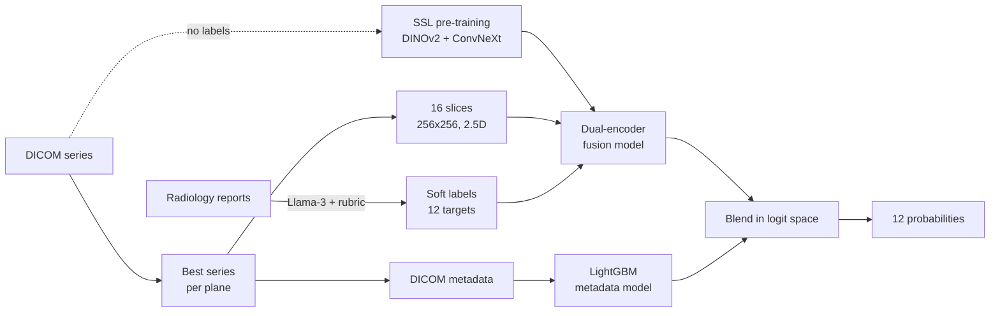
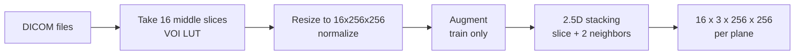
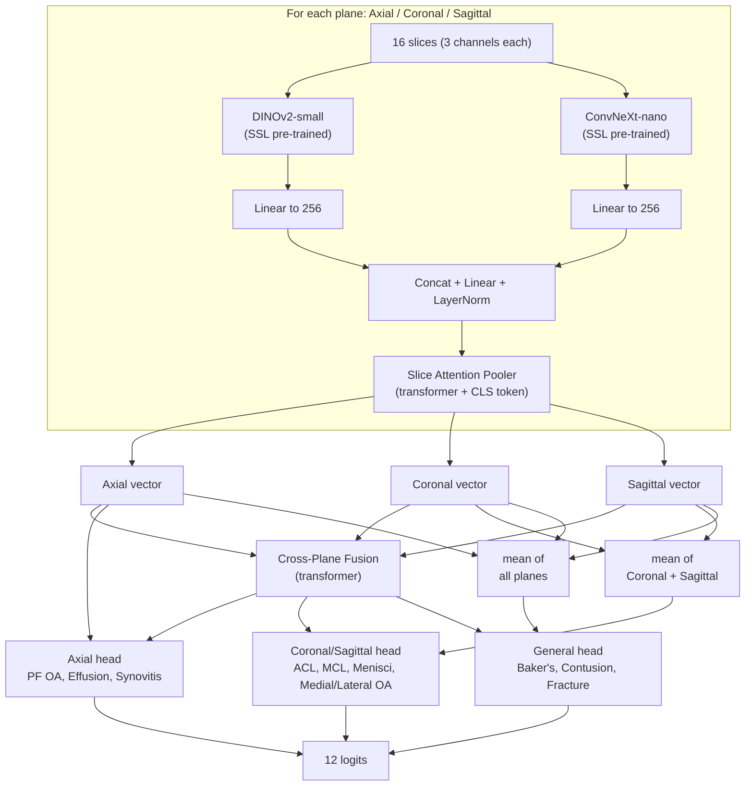

# 🦵 RSNA Knee Abnormality Detection

A deep learning pipeline that reads knee MRI studies and predicts **12 knee problems** at the same time. Built for the RSNA Knee Abnormality Detection Kaggle competition.

**Metric:** macro ROC-AUC over the 12 targets.

| Group | Targets |
|---|---|
| Ligaments | ACL, MCL |
| Menisci | Medial Meniscus, Lateral Meniscus |
| Cartilage (OA) | Medial OA, Lateral OA, PF OA |
| Fluid / soft tissue | Effusion, Synovitis, Baker's cyst |
| Bone | Contusion, Fracture |

---

## 💡 The Main Challenge

Only **58 of 4,407 studies** have real (ground-truth) labels. The rest only have a text radiology report (in many languages).

**Our solution:**
1. Turn reports into labels with an LLM.
2. Pre-train image encoders without labels (self-supervised learning).
3. Train a multi-plane model, then add a small metadata model on top.

---

## 🗺️ Pipeline Overview



---

## 🧹 Data Preprocessing

### 1. Label extraction from reports
`Preprocessing/label_extraction.ipynb`

- Model: **Llama-3-8B-Instruct** reads each report and gives each target a score.
- A strict rubric matches how the official labels work: only *moderate / high-grade / acute* findings are positive.
- Works for English, Spanish, German, Turkish, Greek, Dutch, Bulgarian and more.

| Score | Meaning |
|---|---|
| 1.0 | Clearly positive |
| 0.7 | Stated, but no severity given |
| 0.3 | Mentioned, but mild / below threshold |
| 0.1 | Not mentioned |
| 0.0 | Normal / negated |

Result: macro AUC on the 58 true-label studies went from about **0.80 to 0.85** after improving the rubric.

### 2. Series selection
`Preprocessing/light_df.py`

Each study has many series. For every plane (Axial, Coronal, Sagittal) we keep **one** series, in this order:
1. Fluid-sensitive **and** fat-suppressed
2. Fluid-sensitive only
3. Anything else

### 3. Image loading
`dataset/loader_3d.py`, `dataset/augmentation.py`, `dataset/stack_neighbor.py`



- **Augmentation (MONAI):** flips, rotation, zoom, noise, intensity shift/scale, bias field, Gibbs noise.
- **2.5D:** every slice is stacked with its previous and next slice as 3 channels, so a normal 2D network can see a little 3D context.
- Missing or broken planes are replaced by zeros, so one bad file never stops training.

### 4. Metadata features
`Preprocessing/feature_engineering.py`

33 features per plane (99 per study): scanner brand, field strength, sequence type, flip angle, image size, fluid / fat-suppression flags, and more. Numbers are scaled, missing values are set to `-1`.

---

## 🧠 Model Architecture

`model/MRI25DFusionModelViewRoutingDualEncoder.py`



**Key ideas**

| Idea | Why |
|---|---|
| **Two encoders** (transformer + CNN) | They learn different things; combining them is stronger. |
| **Slice attention pooler** | Learns which slices matter and turns 16 slices into 1 vector. |
| **Cross-plane fusion** | Lets the three planes share information. |
| **View routing** | Each target uses the plane where doctors usually see it best. |

---

## 🎓 Self-Supervised Pre-training

`SSL/dino_ssl.py` (DINOv2-small) and `SSL/convnext_ssl.py` (ConvNeXt-nano)

- Method: DINO-style **self-distillation**. A student learns to match a slowly-updated teacher on different crops of the same slice. **No labels needed.**
- Uses all knee MRI slices from every series.
- Only the last blocks are trained, with a small learning rate.
- A **linear probe** on the 58 true-label studies checks if the features really improve (loss alone is not enough).

---

## 🏋️ Training

`train/Trainer.py`

| Setting | Value |
|---|---|
| Loss | BCE with logits (soft labels) |
| Optimizer | AdamW (backbone `1e-5`, heads `1e-4`) |
| Schedule | Cosine, 30 cycles × 3 data chunks |
| Backbones | Frozen first, then unfrozen step by step (last DINOv2 blocks / ConvNeXt stages) |
| Batch | Effective batch 128 with gradient accumulation |
| Precision | Mixed precision (AMP) |
| Stopping | Early stopping (patience 6) |
| Validation | 10% held-out split **and** the 58 true-label studies |

---

## 🧾 Metadata Model and Blending

`Trainer.meta_trainer()` and `utils/utils.py`

- Metadata alone is weak (**about 0.64 val AUC**) but adds a different signal.
- Logistic Regression, LightGBM and HistGradientBoosting are tested. The best one on validation is used (LightGBM).
- The final prediction mixes both in logit space:

```
final = sigmoid( logit(image_prob) + w * logit(metadata_prob) )
```

- The weight `w` is chosen on validation with bootstrap checks. If the gain is not reliable, `w = 0` (image model only).
- A per-label version (`fit_label_weights`) is also available.

---

## 🔍 Explainability (XAI)

`XAI/xai.py`, results in `assets/XAI/xai_out/`

Three tools show *why* the model answers the way it does:

1. **Plane deletion:** hide one plane and see how much the score drops.
2. **Slice deletion:** hide one slice at a time.
3. **Grad-CAM:** heat maps from both encoders.

**What we found (mean over 58 true-label studies):**

| Target | Most important plane(s) |
|---|---|
| ACL | Sagittal, Axial |
| Medial / Lateral OA | Coronal |
| Medial Meniscus | Coronal |
| Synovitis, Effusion | Axial |
| Contusion, Fracture | Sagittal, Axial |

This matches how radiologists read knee MRI, which is a good sign the model learns real patterns.

---

## 📁 Repository Structure

```
├── main.py                  # Train + run XAI
├── configs.py               # All settings and data paths
├── dataset/
│   ├── KneeDataset.py       # Study-level dataset (3 planes + labels)
│   ├── SafeSubmissionDataset.py
│   ├── loader_3d.py         # DICOM loading
│   ├── augmentation.py      # MONAI transforms
│   └── stack_neighbor.py    # 2.5D stacking
├── model/
│   ├── MRI25DFusionModelViewRoutingDualEncoder.py
│   ├── SliceEncoder.py
│   ├── SliceAttentionPooler.py
│   ├── CrossModalFusion.py
│   └── MetaEncoder.py
├── SSL/                     # Self-supervised pre-training
├── Preprocessing/           # Labels, series selection, metadata
├── train/Trainer.py         # Training, validation, blending
├── utils/utils.py           # Metrics, blending, collate, memory tools
├── XAI/                     # Explainability code
├── notebook/                # Kaggle notebooks
└── assets/                  # Data, checkpoints, XAI outputs
```

---

## 🚀 Quick Start

```bash
pip install torch timm transformers monai==1.4.0 pydicom \
            lightgbm scikit-learn pandas numpy matplotlib tqdm psutil
```

1. Put the CSV files in `assets/data/` (see `configs.py` for names).
2. Run the label extraction notebook, SSL scripts, and metadata preprocessing.
3. Train and explain:

```bash
python main.py
```

> **Note:** Some paths (SSL weights, DICOM folders) are set for Kaggle (`/kaggle/input/...`). Change them for your own setup.

---

## 📌 Results Summary

| Item | Result |
|---|---|
| Report labels vs true labels (58 studies) | macro AUC ≈ 0.849 |
| Metadata model only | ≈ 0.64 (val) |
| Public leaderboard (dinov2 model only) | ≈ 0.795 |
| Private leaderboard (dinov2 model only) | ≈ 0.803 |
| Public leaderboard (dinov2 model + weighted(0.2) meta ) | ≈ 0.786 |
| Private leaderboard (dinov2 model + weighted (0.2) meta) | ≈ 0.794 |
| Public leaderboard (dinov2 model + weighted(0.3) meta ) | ≈ 0.795 |
| Private leaderboard (dinov2 model + weighted (0.3) meta) | ≈ 0.803 |
| Public leaderboard (dual encoder) | ≈ 0.813 |
| Private leaderboard (dual encoder) | ≈ 0.819 |
| Public leaderboard (ensemble: dual encoder + dinov2 + conv_nano ) | ≈ 0.815 |
| Private leaderboard (ensemble: dual encoder+ dinov2 + conv_nano) | ≈ 0.819 |
---

## 🔮 Future Work

- Use all series per plane, not just one.
- Higher resolution (e.g. 384 px) in later training stages.
- Better rubric rules for hard targets (OA, Baker's cyst).

---

## 🙏 Acknowledgements

RSNA and Kaggle for the competition and data. DINOv2 (Meta), ConvNeXt (timm), MONAI, Llama-3.