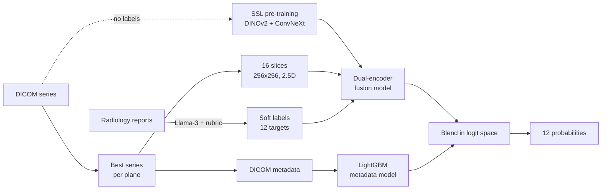
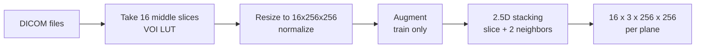
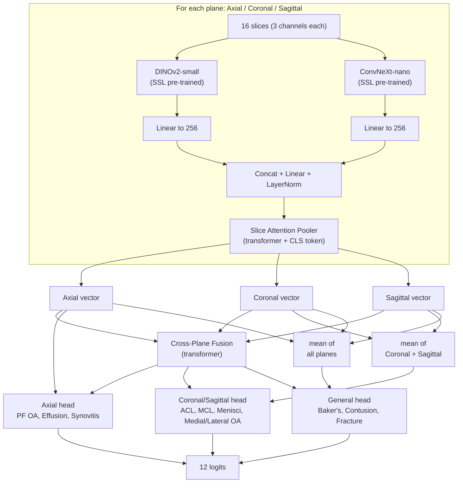
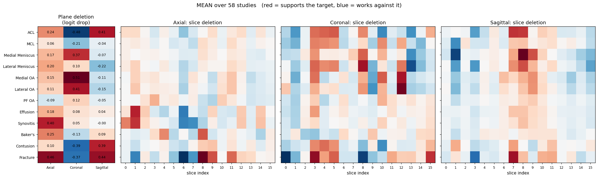
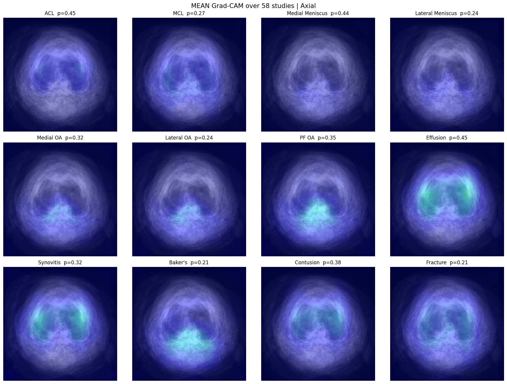
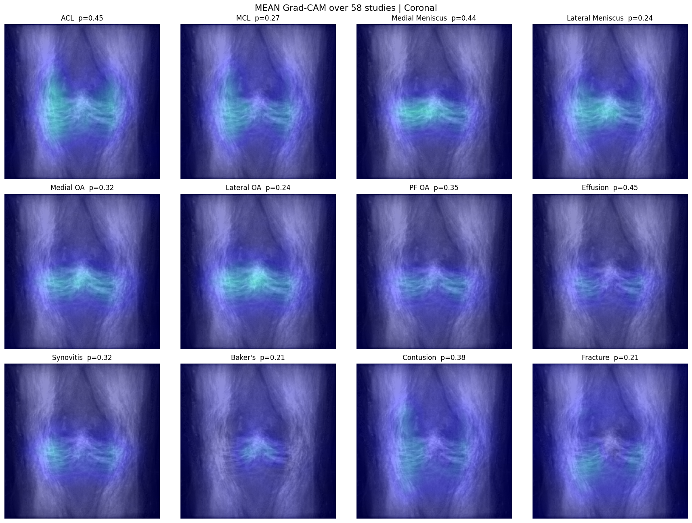
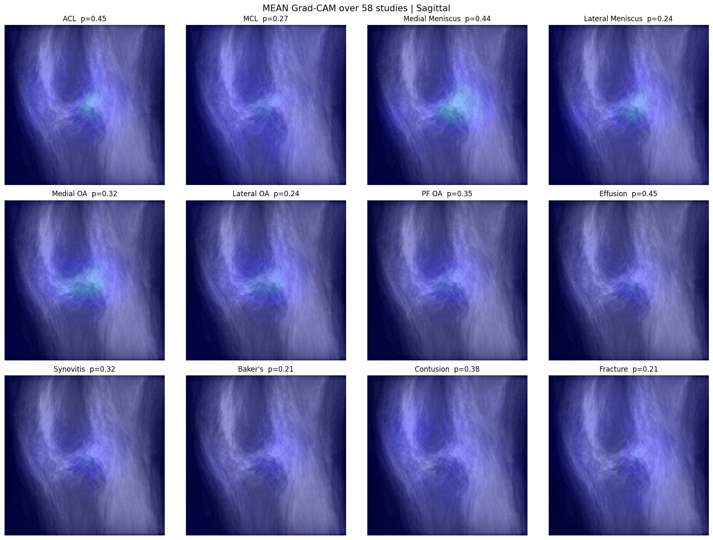

# 🦵 RSNA Knee Abnormality Detection

A deep learning pipeline that reads knee MRI studies and predicts **12 knee problems** at the same time. Built for the RSNA Knee Abnormality Detection Kaggle competition.

**Metric:** macro ROC-AUC over the 12 targets.

| Group | Targets |
|---|---|
| Ligaments | ACL, MCL |
| Menisci | Medial Meniscus, Lateral Meniscus |
| Cartilage (OA) | Medial OA, Lateral OA, PF OA |
| Fluid / soft tissue | Effusion, Synovitis, Baker's cyst |
| Bone | Contusion, Fracture |

---

## 💡 The Main Challenge

Only **58 of 4,407 studies** have real (ground-truth) labels. The rest only have a text radiology report (in many languages).

**Our solution:**
1. Turn reports into labels with an LLM.
2. Pre-train image encoders without labels (self-supervised learning).
3. Train a multi-plane model, then add a small metadata model on top.

---

## 🗺️ Pipeline Overview



---

## 🧹 Data Preprocessing

### 1. Label extraction from reports
`Preprocessing/label_extraction.ipynb`

- Model: **Llama-3-8B-Instruct** reads each report and gives each target a score.
- A strict rubric matches how the official labels work: only *moderate / high-grade / acute* findings are positive.
- Works for English, Spanish, German, Turkish, Greek, Dutch, Bulgarian and more.

| Score | Meaning |
|---|---|
| 1.0 | Clearly positive |
| 0.7 | Stated, but no severity given |
| 0.3 | Mentioned, but mild / below threshold |
| 0.1 | Not mentioned |
| 0.0 | Normal / negated |

Result: macro AUC on the 58 true-label studies went from about **0.80 to 0.85** after improving the rubric.

**Prompt design comparison** (AUC of the extracted labels vs. the true labels of the 58 ground-truth studies):

- **All at once:** one prompt scores all 12 targets in a single call.
- **Target by target:** each target (or pair of related targets) gets its own prompt with its own rules. This was better because the model focuses on one finding at a time.

| Target | All 12 at once | Target by target | Change |
|---|---|---|---|
| ACL | 0.7886 | **0.9387** | +0.150 |
| MCL | 0.8345 | **0.9002** | +0.066 |
| Medial Meniscus | 0.7963 | **0.9008** | +0.105 |
| Lateral Meniscus | 0.7814 | **0.8149** | +0.034 |
| Medial OA | 0.8953 | 0.8953 | 0.000 |
| Lateral OA | 0.8636 | 0.8636 | 0.000 |
| PF OA | 0.7477 | **0.7613** | +0.014 |
| Effusion | 0.7174 | **0.7422** | +0.025 |
| Synovitis | 0.6685 | **0.7336** | +0.065 |
| Baker's | 0.8967 | **0.9339** | +0.037 |
| Contusion | **0.8205** | 0.8131 | -0.007 |
| Fracture | 0.8299 | **0.8917** | +0.062 |
| **Macro AUC** | 0.8034 | **0.8491** | **+0.046** |

Ten of the 12 targets improved. ACL and Medial Meniscus gained the most. Medial and Lateral OA are unchanged, and Contusion is almost the same.

### 2. Series selection
`Preprocessing/light_df.py`

Each study has many series. For every plane (Axial, Coronal, Sagittal) we keep **one** series, in this order:
1. Fluid-sensitive **and** fat-suppressed
2. Fluid-sensitive only
3. Anything else

### 3. Image loading
`dataset/loader_3d.py`, `dataset/augmentation.py`, `dataset/stack_neighbor.py`



- **Augmentation (MONAI):** flips, rotation, zoom, noise, intensity shift/scale, bias field, Gibbs noise.
- **2.5D:** every slice is stacked with its previous and next slice as 3 channels, so a normal 2D network can see a little 3D context.
- Missing or broken planes are replaced by zeros, so one bad file never stops training.

### 4. Metadata features
`Preprocessing/feature_engineering.py`

33 features per plane (99 per study): scanner brand, field strength, sequence type, flip angle, image size, fluid / fat-suppression flags, and more. Numbers are scaled, missing values are set to `-1`.

---

## 🧠 Model Architecture

`model/MRI25DFusionModelViewRoutingDualEncoder.py`



**Key ideas**

| Idea | Why |
|---|---|
| **Two encoders** (transformer + CNN) | They learn different things; combining them is stronger. |
| **Slice attention pooler** | Learns which slices matter and turns 16 slices into 1 vector. |
| **Cross-plane fusion** | Lets the three planes share information. |
| **View routing** | Each target uses the plane where doctors usually see it best. |

---

## 🎓 Self-Supervised Pre-training

`SSL/dino_ssl.py` (DINOv2-small) and `SSL/convnext_ssl.py` (ConvNeXt-nano)

- Method: DINO-style **self-distillation**. A student learns to match a slowly-updated teacher on different crops of the same slice. **No labels needed.**
- Uses all knee MRI slices from every series.
- Only the last blocks are trained, with a small learning rate.
- A **linear probe** on the 58 true-label studies checks if the features really improve (loss alone is not enough).
|  | DINOv2-small | ConvNeXt-nano |
|---|---|---|
| Epochs | 20 | 16 |
|Macro AUC score before and after | 0.5639 ---> 0.5846 | 0.5692 ---> 0.5986 |
---

## 🏋️ Training

`train/Trainer.py`

| Setting | Value |
|---|---|
| Loss | BCE with logits (soft labels) |
| Optimizer | AdamW (backbone `1e-5`, heads `1e-4`) |
| Schedule | Cosine, 30 cycles × 3 data chunks |
| Backbones | Frozen first, then unfrozen step by step (last DINOv2 blocks / ConvNeXt stages) |
| Batch | Effective batch 128 with gradient accumulation |
| Precision | Mixed precision (AMP) |
| Stopping | Early stopping (patience 6) |
| Validation | 10% held-out split **and** the 58 true-label studies |

---

## 🧾 Metadata Model and Blending

`Trainer.meta_trainer()` and `utils/utils.py`

- Metadata alone is weak (**about 0.64 val AUC**) but adds a different signal.
- Logistic Regression, LightGBM and HistGradientBoosting are tested. The best one on validation is used (LightGBM).
- The final prediction mixes both in logit space:

```
final = sigmoid( logit(image_prob) + w * logit(metadata_prob) )
```

- The weight `w` is chosen on validation with bootstrap checks. If the gain is not reliable, `w = 0` (image model only).
- A per-label version (`fit_label_weights`) is also available.

---

## 🔍 Explainability (XAI)

`XAI/xai.py` · outputs in `assets/XAI/xai_out/`

We check *why* the model gives its answers on the 58 ground-truth studies, using three tools:

| Tool | What it does |
|---|---|
| **Plane deletion** | Hide one plane, see how much the score drops (logit drop). |
| **Slice deletion** | Hide one slice at a time, same idea. |
| **Grad-CAM** | Heat map showing where the image encoders look (DINOv2 + ConvNeXt averaged). |

> **How to read the numbers:** a **positive** value means the plane or slice *supports* the target. A **negative** value means the model scores higher when it is hidden, so it *works against* the target.

### Which plane matters for which target?

Mean logit drop over 58 studies. `%` = share of studies where the plane helped.

| Target | Axial | Coronal | Sagittal | Main evidence |
|---|---|---|---|---|
| ACL | 0.24 (78%) | -0.48 (24%) | **0.41** (90%) | Sagittal + Axial |
| MCL | 0.06 | -0.21 | -0.04 | Weak everywhere |
| Medial Meniscus | 0.17 (88%) | **0.37** (81%) | -0.07 | Coronal + Axial |
| Lateral Meniscus | **0.20** (79%) | 0.10 | -0.22 | Axial |
| Medial OA | 0.15 | **0.51** (71%) | -0.11 | Coronal |
| Lateral OA | 0.11 | **0.41** (76%) | -0.15 | Coronal |
| PF OA | -0.09 | 0.12 | -0.05 | Weak everywhere |
| Effusion | **0.18** | 0.08 | 0.04 | Axial |
| Synovitis | **0.40** (71%) | 0.05 | 0.00 | Axial |
| Baker's cyst | **0.25** | -0.13 | 0.09 | Axial |
| Contusion | 0.10 | -0.39 (24%) | **0.39** (86%) | Sagittal |
| Fracture | **0.46** | -0.37 | **0.44** (88%) | Axial + Sagittal |

<p align="center">
  
</p>
<p align="center"><em>Left: plane importance. Right: which slices matter (red = supports, blue = works against).</em></p>

### Main findings

1. **Each target uses a sensible plane.**
   - Cartilage (Medial / Lateral OA) and the medial meniscus rely on the **coronal** plane, where the joint line and joint space are easy to see.
   - ACL, contusion and fracture rely on the **sagittal** plane (and axial for fracture).
   - Effusion, synovitis and Baker's cyst rely on the **axial** plane, where fluid and the back of the knee are visible.
2. **Coronal can work against some targets.** For ACL, MCL, contusion and fracture, hiding the coronal plane *raises* the score. The model likely uses it as a "no abnormality here" signal, or it adds noise for these targets.
3. **Routing helps, but is not perfect.** ACL and fracture benefit from the axial plane even though they are not routed to it. This information comes through the shared fusion vector.
4. **Weak spots:** MCL and PF OA get little support from any plane. PF OA is routed to the axial plane, but the axial plane does not help it. These targets are the best candidates for future work.
5. **Slices matter, not just planes.** Importance is spread over a few key slices, not all 16. Examples: sagittal slices 7-8 for ACL and menisci, coronal slices 3-5 for ACL / contusion / fracture, and axial slices 0-1 for effusion and synovitis. Some slices work against the target (blue), so the slice attention is learning to be selective.

### Grad-CAM (mean over 58 studies)

<table>
  <tr>
    <td align="center"><b>Axial</b></td>
    <td align="center"><b>Coronal</b></td>
    <td align="center"><b>Sagittal</b></td>
  </tr>
  <tr>
    <td></td>
    <td></td>
    <td></td>
  </tr>
</table>

What the heat maps show:

- **Axial:** effusion and synovitis light up the joint edges on both sides, where fluid collects. Baker's cyst lights up the back of the knee, which is where this cyst appears.
- **Coronal:** menisci and OA light up along the joint line. ACL and contusion highlight the side of the joint and the nearby bone.
- **Sagittal:** ACL and meniscus targets focus on the centre of the joint (around the notch between the bones).

This matches how radiologists read knee MRI, which suggests the model learns real anatomy and not shortcuts.

**Limits:** results are averaged over only 58 studies, so the mean images look blurry and the per-study spread is large (see `plane_importance_per_study.csv`). Treat the findings as strong hints, not proof.

### Files

| File | Content |
|---|---|
| `plane_importance_mean.csv` | Mean plane importance per target |
| `plane_importance_per_study.csv` | Plane importance for each study |
| `probs.csv` | Predictions and labels for each study |
| `MEAN_importance.png`, `MEAN_cam_*.png` | Average plots |

---

## 📁 Repository Structure

```
├── main.py                  # Train + run XAI
├── configs.py               # All settings and data paths
├── dataset/
│   ├── KneeDataset.py       # Study-level dataset (3 planes + labels)
│   ├── SafeSubmissionDataset.py
│   ├── loader_3d.py         # DICOM loading
│   ├── augmentation.py      # MONAI transforms
│   └── stack_neighbor.py    # 2.5D stacking
├── model/
│   ├── MRI25DFusionModelViewRoutingDualEncoder.py
│   ├── SliceEncoder.py
│   ├── SliceAttentionPooler.py
│   ├── CrossModalFusion.py
│   └── MetaEncoder.py
├── SSL/                     # Self-supervised pre-training
├── Preprocessing/           # Labels, series selection, metadata
├── train/Trainer.py         # Training, validation, blending
├── utils/utils.py           # Metrics, blending, collate, memory tools
├── XAI/                     # Explainability code
├── notebook/                # Kaggle notebooks
└── assets/                  # Data, checkpoints, XAI outputs
```

---

## 🚀 Quick Start

```bash
pip install torch timm transformers monai==1.4.0 pydicom \
            lightgbm scikit-learn pandas numpy matplotlib tqdm psutil
```

1. Put the CSV files in `assets/data/` (see `configs.py` for names).
2. Run the label extraction notebook, SSL scripts, and metadata preprocessing.
3. Train and explain:

```bash
python main.py
```

> **Note:** Some paths (SSL weights, DICOM folders) are set for Kaggle (`/kaggle/input/...`). Change them for your own setup.

---

## 📌 Results Summary

| Item | Result |
|---|---|
| **Kaggle public leaderboard (final model)** | **0.81** macro AUC |
| Early version (DINOv2 only) | 0.79 |
| Report labels vs true labels (58 studies) | ≈ 0.85 |
| Metadata model only | ≈ 0.64 (validation) |

**Per-target AUC on the 58 XAI studies** (labels from `probs.csv`, split at 0.5; macro ≈ 0.80):

| Strong (≥ 0.85) | Medium (0.80 - 0.85) | Weak (< 0.80) |
|---|---|---|
| Medial OA 0.90, Baker's 0.88, Effusion 0.85, Fracture 0.85 | ACL 0.84, Lateral OA 0.84, PF OA 0.84, Contusion 0.84, Synovitis 0.80 | Lateral Meniscus 0.68, MCL 0.71, Medial Meniscus 0.59 |

The menisci and MCL are the hardest targets. For the MCL this fits the XAI result (weak support from every plane). For the menisci, the planes do help, so the problem is likely subtle tear details, not the view.

---

## 🔮 Future Work

- Use all series per plane, not just one.
- Higher resolution (e.g. 384 px) in later training stages.
- Ensemble the dual-encoder model with single-encoder models.
- Better rubric rules for hard targets (OA, Baker's cyst).
- Improve the weak targets (menisci, MCL, PF OA) with higher resolution or targeted routing.

---

## 🙏 Acknowledgements

RSNA and Kaggle for the competition and data. DINOv2 (Meta), ConvNeXt (timm), MONAI, Llama-3.